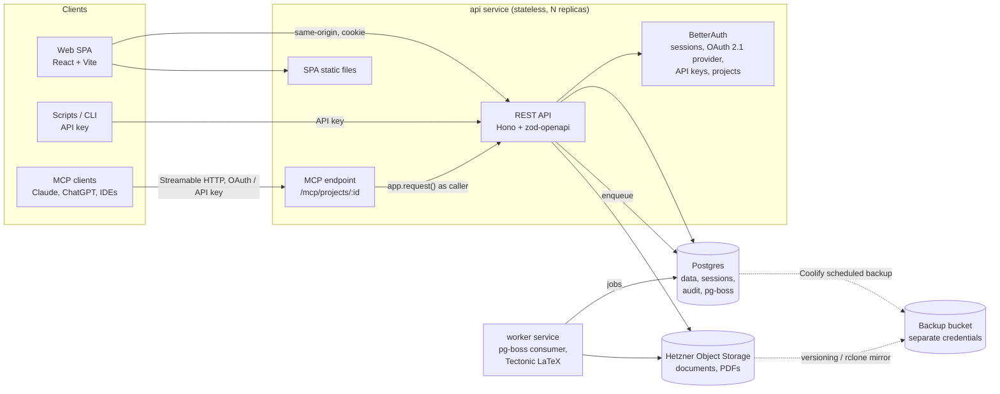
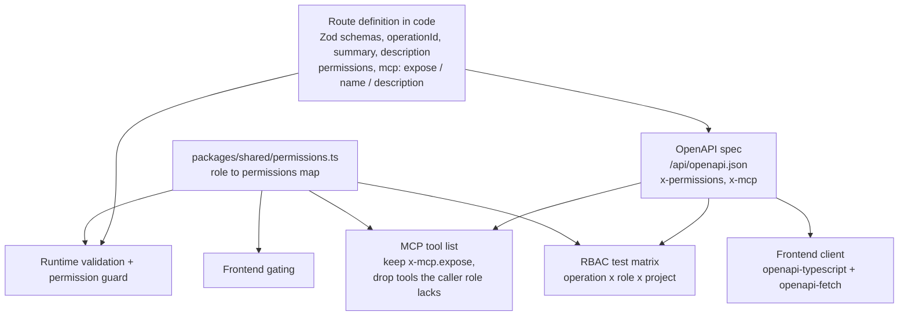
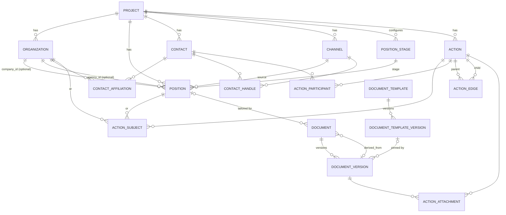

# Architecture overview

A consolidated view of the accepted decisions. The ADRs in `docs/adr/` are the source of truth and carry the reasoning;
this page shows the result with all amendments applied. If the two disagree, the ADR wins and this page needs fixing.

## What it is

A self-hosted CRM for running a job search: organizations (companies and agencies), positions, contacts, and a graph of
actions (emails, meetings, interviews, applications, take-homes, offers, …). Projects can be shared with a coach, a recruiter or a partner.
Everything is reachable through a REST API, the web SPA, and an MCP server whose tools are generated from the API's OpenAPI spec.

## System



- **Deployment**: Coolify on a VPS, with Coolify-managed Postgres. One image runs as two services, `api` and `worker`. Configuration comes from env vars only. (0011, 0024, 0027)
- **Stateless**: no local files, in-memory sessions or in-process caches, so any replica can serve any request. (0011)
- **Same origin**: the API serves the SPA build, so auth uses cookies and no CORS setup is needed. (0011)

## One definition, many consumers

The core mechanism: each route is declared once, and REST, the spec, MCP and the frontend all derive from that declaration.



- A route without `permissions` does not compile. (0009)
- MCP tools run through the same Hono app as the caller, so validation and authorization can't differ from REST. (0010)
- Each MCP connection is bound to one project (`/mcp/projects/{projectId}`), so the tool list is fixed for the whole connection. (0010)
- MCP exposes only tools. Composite operations (`getPositionOverview`, `getAgenda`, `logInteraction`) keep round trips down. (0018)

## Access model

| Role | Read | Comment | Write domain data | Manage members | Transfer / delete project |
|---|---|---|---|---|---|
| owner (exactly one) | ✓ | ✓ | ✓ | ✓ | ✓ |
| editor | ✓ | ✓ | ✓ | | |
| commenter | ✓ | ✓ | | | |
| viewer | ✓ | | | | |

- Project = BetterAuth organization. Single ownership is enforced in our code, with an explicit ownership transfer. (0007)
- Trust model: members see the **whole** project. There are no private records or hidden fields. The audit log is the one exception: only the owner can read it. (0015, 0033)
- Tenancy is filtered in the application (no RLS): every repository call requires a `projectId`. (0003)
- The first user to sign up becomes instance admin. After that, sign-up is invite-only. Login is by email and password, plus optional Google or GitHub. (0021)

## Domain model



The diagram leaves out comments, notifications and the audit log; they are listed under Cross-cutting below.

| Entity | Key points | ADR |
|---|---|---|
| Organization | `kind: company \| agency`, a single table | 0002 |
| Position | optional company, optional agency; `url` + pasted `description_markdown` (never scraped); salary range; `stage` (per-project, configurable) + `outcome` (`open`/`accepted`/`rejected`/`withdrawn`/`ghosted`) | 0002, 0014, 0026 |
| Contact | affiliation history with optional dates; one handle per channel | 0002 |
| Channel | per project, seeded from the defaults config | 0002, 0003 |
| Action | closed type enum with a per-type payload (discriminated union); status `planned`/`done`/`cancelled`/`no_show`/`rescheduled`; reschedule = old action marked `rescheduled` + a new one linked to it | 0004, 0029 |
| Action subject | many-to-many to a position **or** an organization; zero subjects = a project-level action; organization timelines are derived through positions | 0013 |
| Action edge | parent → child; `follow_up`/`subtask`/`blocks`/`rescheduled`/`related`; cross-company allowed, cross-project rejected; cycles allowed (with a warning), all traversals cycle-safe | 0005 |
| Document | main resume (no position) or tailored (position + `derived_from`); versions are immutable; actions attach **versions** | 0006 |
| LaTeX version | `.tex` source as text in Postgres + a pinned template version (`.cls`, fonts) + a PDF compiled by the worker | 0025 |

Action types: `email`, `meeting`, `interview`, `application`, `take_home`, `offer`, `reference_check`, `rejection`, `task`, `note`.
Fields and allowed statuses are listed in [`domain/action-types.md`](domain/action-types.md).

## Cross-cutting

| Concern | Decision | ADR |
|---|---|---|
| IDs | UUIDv7 in the DB; prefixed IDs in the API (`pos_…`, `act_…`) | 0020 |
| Time | stored as UTC `timestamptz`; a per-user IANA timezone for display and agenda day boundaries | 0020 |
| History | `audit_event` per change, including `via: web \| api_key \| mcp`; written in the same transaction | 0012 |
| Deletion | soft delete everywhere; hard purge only for contacts (with audit redaction) | 0012, 0017 |
| Concurrency | `version` column, `ETag`/`If-Match` → 412 on conflict; plain `version` body field for MCP | 0012 |
| Notifications | in-app only; reminders computed at read time from dates; event notifications and the 8 AM agenda digest stored as rows | 0016 |
| Search | Postgres full-text search; advanced search in v2 | 0016 |
| Background jobs | pg-boss in Postgres; v1 jobs: `document.compile`, `agenda.digest` (every 10 min; 8 AM local digest of today's tasks) | 0024 |
| Import/export | versioned JSON + zip, round-trippable; CSV import for positions | 0017 |
| Backups | Coolify Postgres backups and a document mirror into a separate bucket with separate credentials | 0027 |
| In-app assistant | sidebar chat in the SPA; agent loop in the API on the user's own provider key (Anthropic, OpenAI, Google); MCP catalog tools in-process, router-derived navigation tool run in the browser; chats private to their author | 0031 |
| Assistant memory | user memory (private, all projects) and project memory (shared, audited, exported); exposed as MCP tools and given to agents in their instructions; viewed and edited on the Memory page | 0032 |

## Codebase

```
apps/api        Hono: REST + BetterAuth + MCP + serves SPA; also the worker entrypoint
apps/web        Vite SPA: React, TanStack Router/Query, shadcn/ui, React Flow
packages/shared Zod schemas, enums, permissions
packages/db     Drizzle schema + migrations
scripts/        e.g. import-resumes (paths given as arguments, never committed)
```
Node LTS, pnpm workspaces. Tests: Vitest, testcontainers Postgres, a generated RBAC matrix, MCP contract snapshots, and Playwright smoke tests. (0019, 0022)

**Repository rules**: nothing personal is committed (fixtures are synthetic; gitleaks runs pre-commit and in CI). License: AGPL-3.0-only. (0028)

## Scope

| v1 | after v1 | v2 |
|---|---|---|
| auth, projects, members, comments, RBAC, MCP; full domain model and action graph UI; documents + LaTeX worker + resume import; agenda, basic search, export/import | audit log UI, offer comparison view | email reminders, mail/calendar sync, ICS feed, advanced search |
